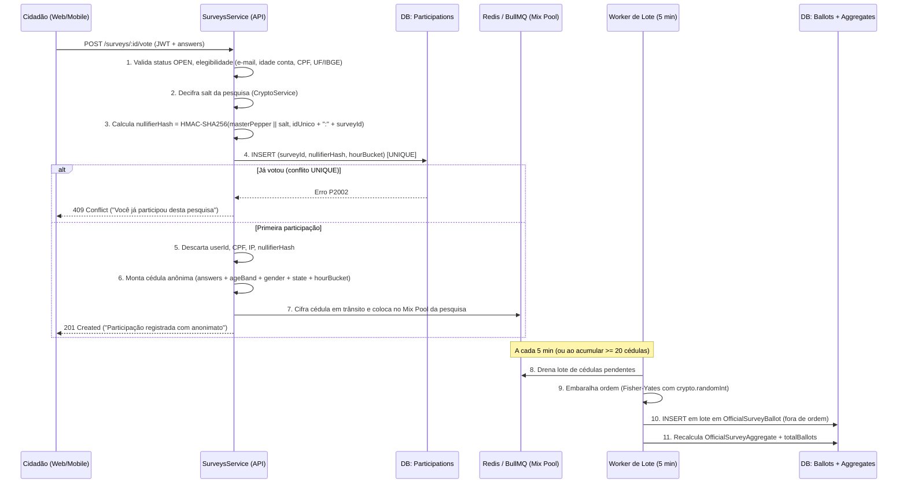

# Pesquisa Votz — Desenho Técnico (Banco, Anonimização Criptográfica e Telas)

> **Origem:** solicitação do dono do produto em 26/11/2026 para criar pesquisas oficiais do sistema ("Pesquisa Votz") — tanto de **intenção de voto** quanto de **avaliação de gestão e temas cívicos** — com anonimização forte, segurança antifraude e conformidade legal.
> **Natureza deste documento:** especificação técnica completa (banco de dados, fluxo criptográfico, API, telas e etapas de implementação). **Ainda sem código implementado.**

## Como retomar

- **Estado (26/11/2026):** **Fases 1 e 2 implementadas e NO AR no Cloud Run (`votz-prod-515716`, `us-central1`)** (sem commit).
  - **Deploy Cloud Run (26/11):** segredo `survey-nullifier-key` criado no Secret Manager; `votz-api` (`api:2026-11-26`) no ar com `OFFICIAL_SURVEYS_ENABLED=true` e as 2 migrations aplicadas automaticamente no Neon; `votz-web` (`web:2026-11-26`, revisão `votz-web-00005-gs6`) servindo 100% do tráfego.
  - **Fase 1 (Base + Cidadão + Admin + Mobile):** Schema + migration `20261126140000_official_surveys`, `@votz/shared-types` (`surveys.ts`), muro de anúncios, `SURVEY_NULLIFIER_KEY`, módulo `apps/api/src/surveys/*` (nullifier HMAC-SHA256, dedup por CPF, Mix Pool cifrado BullMQ + Fisher-Yates com lote mínimo de 5 cédulas, crypto-shredding, quórum/k-anonimato, trava TSE), Web (`/admin` aba Pesquisas, `/pesquisas`, `/pesquisas/:slug`, `FeaturedSurveyCard`, `Navbar`) e Mobile (`/pesquisas`, `/pesquisas/[slug]`, `FeaturedSurveyCard`, menu da conta).
  - **Fase 2 (Monetização / Parceiros / Nível A):** Migration `20261126160000_official_surveys_phase2` (`OfficialSurveyInvitation`, `ResearchInstitute`, `topicKey`, `cooldownDays`, `reviewStatus`), motor de **amostra sorteada (`INVITED_SAMPLE`) com quarentena de 30 dias** por `topicKey`, fluxo de **Consultas Públicas para Entidades** (`/entidade/consultas` no Estúdio + fila de revisão editorial no `/admin`), **Institutos Credenciados** (`/pesquisas/institutos/:slug`), **autocomplete de políticos** no construtor do Admin, **Comparador histórico** por `topicKey`, **exportação CSV/JSON k-anônima** + botão **Copiar Embed**, e **convites exclusivos** no Web e Mobile.
- **O que foi verificado:** `shared-types` build, `prisma generate`, 31 testes unitários (`surveys.rules.spec.ts`, `surveys.service.spec.ts`, `ads-policy.spec.ts`, `route-auth-audit.spec.ts`), `tsc --noEmit` em API, Web e Mobile, e endpoints ao vivo no Cloud Run (`/health`, `/surveys/config`, `/surveys`, `/surveys/institutes`, `/pesquisas`).
- **O que NÃO foi verificado / pendente:** teste interativo no navegador/celular (criar → votar → apurar → encerrar); `eas update` para levar a tela ao APK do celular; revisão jurídica (TSE/RIPD) antes de usuários reais.
- **Próximo passo:** validar no navegador/celular com `OFFICIAL_SURVEYS_ENABLED=true`, ou avançar para **Tema claro/escuro** ou **Configurações de conta**.
- **Arquivos planejados:**
  - `packages/database/prisma/schema.prisma` (novos modelos `OfficialSurvey*`)
  - `packages/shared-types/src/surveys.ts` (tipos, enums, constantes de k-anonimato e copy)
  - `apps/api/src/surveys/*` (controller, service, repository, crypto/nullifier, processor BullMQ, rules)
  - `apps/api/src/ads/ads-policy.spec.ts` (inclusão no muro de anúncios)
  - `apps/web/src/pages/PesquisasList.tsx`, `PesquisaDetail.tsx`, `apps/web/src/components/surveys/*`, aba em `Admin.tsx`
  - `apps/mobile/src/screens/surveys-screen.tsx`, `survey-detail-screen.tsx`

---

## 1. Visão do Produto e Modalidades

A **Pesquisa Votz** é um canal **exclusivamente oficial** (publicado apenas por `ADMIN` do Votz, nunca por políticos, entidades, empresas ou usuários comuns), separado das enquetes informais (`PostPoll` e `DebatePoll`).

### 1.1 Modalidades suportadas
| Modalidade (`SurveyKind`) | Uso principal | Exemplos de perguntas |
|---|---|---|
| `VOTING_INTENTION` | Intenção de voto oficial (estimulada, 1º turno, 2º turno, rejeição) | *"Se a eleição para Prefeito fosse hoje, em quem você votaria?"*, *"Em qual destes nomes você NÃO votaria de jeito nenhum?"* |
| `APPROVAL_RATING` | Avaliação de gestão (Executivo / Legislativo) | *"Como você avalia a gestão atual da Prefeitura?"* (Ótimo, Bom, Regular, Ruim, Péssimo, Não sei) |
| `CIVIC_TOPIC` | Pesquisas temáticas / prioridades da cidade ou país | *"Qual deve ser a prioridade nº 1 do orçamento municipal em 2027?"*, *"Você apoia a proposta X?"* |

### 1.2 Escopo territorial (`SurveyScope`)
- `NATIONAL` — todo o Brasil.
- `STATE` — restrito a uma UF (`targetState`, ex.: `"SP"`).
- `MUNICIPAL` — restrito a um município (`targetIbgeCode` / `targetCity` + `targetState`).

### 1.3 Níveis de elegibilidade (`SurveyVerificationLevel`)
Configurável por pesquisa no momento da criação:
- `STANDARD` (padrão para pesquisas cívicas rápidas): conta autenticada + `emailVerified = true` + conta criada há pelo menos `minAccountAgeDays` (padrão: 7 dias) + não banida.
- `VERIFIED_CPF` (obrigatório para intenção de voto oficial): tudo acima **+** `cpf` cadastrado e validado na conta (permite deduplicação por CPF real, impedindo que uma pessoa crie várias contas para votar múltiplas vezes).

---

## 2. Modelagem Detalhada do Banco (Prisma Schema)

O princípio estrutural é a **separação física absoluta** entre:
1. **Quem participou** (`OfficialSurveyParticipation` — sem resposta)
2. **O que foi respondido** (`OfficialSurveyBallot` — sem usuário, sem CPF, sem IP, sem nullifier)
3. **Fila transitória de embaralhamento** (BullMQ/Redis, nunca persistindo `userId` com a resposta no banco)
4. **Agregados pré-calculados** (`OfficialSurveyAggregate` — leitura ultra-rápida para gráficos e proteção por k-anonimato)

```prisma
// ==================== PESQUISA VOTZ (OFICIAL ANONIMIZADA) ====================

enum SurveyKind {
  VOTING_INTENTION  // Intenção de voto (estimulada, 2º turno, rejeição)
  APPROVAL_RATING   // Avaliação de gestão
  CIVIC_TOPIC       // Pesquisa cívica / temática
}

enum SurveyStatus {
  DRAFT       // Em preparação pelo Admin
  SCHEDULED   // Publicação agendada
  OPEN        // Coleta aberta
  CLOSED      // Coleta encerrada (resultados finais congelados)
  ARCHIVED    // Arquivada (mantida para histórico público)
  CANCELLED   // Cancelada (ex.: trava eleitoral ou irregularidade)
}

enum SurveyScope {
  NATIONAL
  STATE
  MUNICIPAL
}

enum SurveyVerificationLevel {
  STANDARD      // E-mail verificado + idade mínima da conta
  VERIFIED_CPF  // Exige CPF verificado (dedup por CPF)
}

enum SurveyQuestionType {
  SINGLE_CHOICE    // Escolha única (ex.: 1º turno, avaliação)
  MULTIPLE_CHOICE  // Múltipla escolha limitada (ex.: rejeição, até N opções)
  SCALE_5          // Escala 1..5 (ex.: Ótimo a Péssimo)
}

enum SurveyResultsVisibility {
  AFTER_VOTE   // Cidadão vê parciais após votar (e público vê após atingir quórum mínimo)
  AFTER_CLOSE  // Resultados só aparecem quando a pesquisa encerrar (evita efeito manada)
}

model OfficialSurvey {
  id                  String                  @id @default(uuid())
  slug                String                  @unique
  title               String                  @db.VarChar(180)
  subtitle            String?                 @db.VarChar(320)
  description         String                  @db.Text
  kind                SurveyKind
  status              SurveyStatus            @default(DRAFT)
  scope               SurveyScope             @default(NATIONAL)
  targetState         String?                 @map("target_state") @db.VarChar(2)
  targetCity          String?                 @map("target_city") @db.VarChar(120)
  targetIbgeCode      String?                 @map("target_ibge_code") @db.VarChar(10)

  // Elegibilidade e exibição
  verificationLevel   SurveyVerificationLevel @default(STANDARD) @map("verification_level")
  minAccountAgeDays   Int                     @default(7) @map("min_account_age_days")
  resultsVisibility   SurveyResultsVisibility @default(AFTER_CLOSE) @map("results_visibility")
  minQuorumToPublish  Int                     @default(100) @map("min_quorum_to_publish")
  kAnonymityThreshold Int                     @default(30) @map("k_anonymity_threshold")
  featuredInFeed      Boolean                 @default(false) @map("featured_in_feed")

  // Janela de coleta
  startsAt            DateTime?               @map("starts_at")
  endsAt              DateTime?               @map("ends_at")
  closedAt            DateTime?               @map("closed_at")

  // Segredo exclusivo desta pesquisa (cifrado via CryptoService AES-256-GCM).
  // Usado para calcular o nullifierHash. Pode ser destruído (null) após closedAt (crypto-shredding).
  nullifierSaltEnc    String?                 @map("nullifier_salt_enc")
  saltDestroyedAt     DateTime?               @map("salt_destroyed_at")

  // Conformidade TSE / Transparência metodológica
  isElectoral         Boolean                 @default(false) @map("is_electoral")
  tseRegistrationCode String?                 @map("tse_registration_code") @db.VarChar(60)
  statisticianName    String?                 @map("statistician_name") @db.VarChar(140)
  statisticianConre   String?                 @map("statistician_conre") @db.VarChar(40)
  methodologyNote     String                  @map("methodology_note") @db.Text
  disclaimerText      String                  @map("disclaimer_text") @db.Text

  // Auditoria administrativa (quem criou/publicou — nunca quem votou)
  createdById         String                  @map("created_by_id")
  publishedById       String?                 @map("published_by_id")
  totalBallots        Int                     @default(0) @map("total_ballots")
  createdAt           DateTime                @default(now()) @map("created_at")
  updatedAt           DateTime                @updatedAt @map("updated_at")

  questions           OfficialSurveyQuestion[]
  participations      OfficialSurveyParticipation[]
  ballots             OfficialSurveyBallot[]
  aggregates          OfficialSurveyAggregate[]

  @@index([status, featuredInFeed, startsAt])
  @@index([scope, targetState, targetIbgeCode, status])
  @@map("official_surveys")
}

model OfficialSurveyQuestion {
  id                  String             @id @default(uuid())
  surveyId            String             @map("survey_id")
  survey              OfficialSurvey     @relation(fields: [surveyId], references: [id], onDelete: Cascade)
  position            Int
  prompt              String             @db.VarChar(300)
  helpText            String?            @db.VarChar(300) @map("help_text")
  type                SurveyQuestionType @default(SINGLE_CHOICE)
  required            Boolean            @default(true)
  maxSelections       Int                @default(1) @map("max_selections")
  randomizeOptions    Boolean            @default(true) @map("randomize_options")
  // Opções fixas no final (ex.: Branco/Nulo, Indeciso) não entram no embaralhamento
  options             OfficialSurveyOption[]

  @@unique([surveyId, position])
  @@map("official_survey_questions")
}

model OfficialSurveyOption {
  id                  String                 @id @default(uuid())
  questionId          String                 @map("question_id")
  question            OfficialSurveyQuestion @relation(fields: [questionId], references: [id], onDelete: Cascade)
  position            Int
  label               String                 @db.VarChar(160)
  subtitle            String?                @db.VarChar(160) // ex.: partido / cargo
  imageUrl            String?                @map("image_url")
  // Opcional: referência visual ao cadastro de político do Votz (foto/partido), sem dar controle ao político
  politicianId        String?                @map("politician_id")
  // Se true, fica sempre no final da lista (ex.: "Branco / Nulo", "Não sei / Indeciso")
  isPinnedBottom      Boolean                @default(false) @map("is_pinned_bottom")

  @@unique([questionId, position])
  @@map("official_survey_options")
}

/// TABELA A: Controle estrito de 1 voto por pessoa.
/// NÃO contém resposta, NÃO aponta para nenhuma cédula, NÃO guarda IP.
model OfficialSurveyParticipation {
  id                  String         @id @default(uuid())
  surveyId            String         @map("survey_id")
  survey              OfficialSurvey @relation(fields: [surveyId], references: [id], onDelete: Cascade)
  // HMAC-SHA256(saltDaPesquisa, "u:" + userId) ou "cpf:" + cpfDigitsNormalizado
  nullifierHash       String         @map("nullifier_hash") @db.VarChar(64)
  // Arredondado para janela de hora (nunca timestamp exato) para impedir correlação temporal
  participatedBucket  DateTime       @map("participated_bucket")

  @@unique([surveyId, nullifierHash])
  @@index([surveyId])
  @@map("official_survey_participations")
}

/// TABELA B: Cédula 100% anônima.
/// ZERO referência a User, CPF, nullifierHash, IP ou deviceId.
/// Inserida fora de ordem via lote embaralhado (BullMQ).
model OfficialSurveyBallot {
  id                  String         @id @default(uuid())
  surveyId            String         @map("survey_id")
  survey              OfficialSurvey @relation(fields: [surveyId], references: [id], onDelete: Cascade)

  // Respostas estruturadas: { "<questionId>": ["<optionId>", ...] }
  answersJson         Json           @map("answers_json")

  // Recortes grosseiros (apenas faixas — nunca data de nascimento, nunca endereço/bairro)
  ageBand             String?        @map("age_band") @db.VarChar(16)     // "16-24", "25-34", "35-44", "45-59", "60+"
  gender              String?        @db.VarChar(24)                      // UserGender enum ou null
  state               String?        @db.VarChar(2)                       // UF do participante
  ibgeCode            String?        @map("ibge_code") @db.VarChar(10)    // Apenas se município > 50k hab ou pesquisa municipal

  // Timestamp arredondado para hora cheia (ou dia) — nunca milissegundo real
  submittedBucket     DateTime       @map("submitted_bucket")

  @@index([surveyId, submittedBucket])
  @@index([surveyId, state])
  @@map("official_survey_ballots")
}

/// Agregação materializada para consultas rápidas de gráficos e aplicação garantida de k-anonimato.
model OfficialSurveyAggregate {
  id                  String         @id @default(uuid())
  surveyId            String         @map("survey_id")
  survey              OfficialSurvey @relation(fields: [surveyId], references: [id], onDelete: Cascade)
  questionId          String         @map("question_id")
  optionId            String         @map("option_id")
  // Dimensão de recorte: "ALL", "STATE:SP", "AGE:25-34", "GENDER:FEMALE"
  segmentKey          String         @map("segment_key") @db.VarChar(64)
  votesCount          Int            @default(0) @map("votes_count")
  segmentTotal        Int            @default(0) @map("segment_total")
  updatedAt           DateTime       @updatedAt @map("updated_at")

  @@unique([surveyId, questionId, optionId, segmentKey])
  @@index([surveyId, segmentKey])
  @@map("official_survey_aggregates")
}
```

### Por que essa modelagem é segura?
- **Zero chave estrangeira entre `User` e `OfficialSurveyBallot`:** mesmo com acesso `SELECT *` ao PostgreSQL, não existe caminho relacional ligando uma pessoa a uma cédula.
- **Zero chave estrangeira entre `OfficialSurveyParticipation` e `OfficialSurveyBallot`:** os dois registros não compartilham ID, nem ordem sequencial (UUID v4 aleatório), nem timestamp preciso.
- **Sem bairro/CEP na cédula:** guardar bairro + faixa etária + gênero poderia reidentificar pessoas em bairros pequenos. Na cédula só entram `ageBand`, `gender`, `state` e (quando aplicável) `ibgeCode`.
- **Exclusão de conta LGPD (`DELETE /users/me`):** como a cédula não pertence a nenhum `userId`, apagar a conta não compromete a integridade estatística da pesquisa — e o `nullifierHash` já não expõe dados pessoais (e fica irrecuperável após o crypto-shredding do salt).

---

## 3. Fluxo Criptográfico de Anonimização e Segurança

### 3.1 Diagrama do fluxo de votação (Double-Envelope + Mix Batch)



### 3.2 Detalhes criptográficos críticos
1. **Chave de Pepper separada (`SURVEY_NULLIFIER_KEY`):**
   - Variável de ambiente de 32 bytes (64 hex chars), independente da `CPF_ENCRYPTION_KEY`.
   - Ao criar uma `OfficialSurvey`, o sistema gera `surveySalt = randomBytes(32)` e armazena `nullifierSaltEnc = cryptoService.encrypt(surveySalt.toString('hex'))`.
   - O cálculo do nullifier combina os dois segredos:
     ```ts
     const key = createHmac('sha256', SURVEY_NULLIFIER_KEY).update(surveySalt).digest()
     const subject = survey.verificationLevel === 'VERIFIED_CPF'
       ? `cpf:${cpfDigits}`
       : `usr:${user.id}`
     const nullifierHash = createHmac('sha256', key)
       .update(`${survey.id}:${subject}`)
       .digest('hex')
     ```
2. **Crypto-Shredding no encerramento:**
   - Quando a pesquisa muda para `CLOSED` (após esvaziar o Mix Pool), um job zera `nullifierSaltEnc = null` e grava `saltDestroyedAt = now()`.
   - Consequência: mesmo que alguém obtenha o backup do banco + todas as chaves do servidor no futuro, é **matematicamente impossível** verificar sequer *se* o cidadão X participou daquela pesquisa encerrada.
3. **Recibo para o cidadão saber que já votou:**
   - Enquanto a pesquisa estiver `OPEN`, `GET /surveys/:id` recalcula `nullifierHash` em memória e checa `EXISTS` em `OfficialSurveyParticipation` para devolver `hasVoted: true | false` (nunca devolve em quem votou, porque o sistema não sabe!).
   - Após `CLOSED` (com salt destruído), a UI simplesmente exibe "Pesquisa encerrada — veja os resultados".
4. **Proteção contra Timing Attack (Mix Pool):**
   - Cédulas nunca são gravadas individualmente no momento da requisição HTTP.
   - Elas entram em uma lista criptografada no Redis (`survey:mix:<surveyId>`) e um worker BullMQ drena em lotes (a cada 5 minutos ou ao atingir 20 cédulas), aplica embaralhamento criptográfico (`Fisher-Yates` com `crypto.randomInt`) e faz `createMany` no PostgreSQL com `submittedBucket` arredondado para a hora cheia.
   - Em caso de encerramento da pesquisa, o worker força o flush final do pool antes de fechar a apuração.
5. **K-anonimato rigoroso nos resultados:**
   - Nenhum recorte (`STATE`, `AGE`, `GENDER`) é retornado pela API se `segmentTotal < survey.kAnonymityThreshold` (padrão `30`).
   - Recortes cruzados (ex.: `STATE + AGE + GENDER`) só ficam disponíveis em pesquisas com volume grande e também sujeitos à regra `>= k` em todas as células.
   - Enquanto `totalBallots < survey.minQuorumToPublish` (padrão `100`), a API retorna `quorumReached: false` e **não exibe percentuais**, evitando vazamento de votos iniciais.
6. **Randomização de opções (anti-viés de posição):**
   - Quando `question.randomizeOptions = true`, o servidor embaralha a ordem das opções com `isPinnedBottom = false` a cada carregamento da tela de votação, mantendo sempre no final as opções fixas (*"Branco / Nulo"*, *"Indeciso / Não sei"*).
7. **Muro de privacidade com Anúncios (`ads-policy.spec.ts`):**
   - Adicionar `official_surveys` em `ADS_FORBIDDEN_SOURCES` em `packages/shared-types/src/ads.ts`.
   - Adicionar `officialSurvey`, `officialSurveyQuestion`, `officialSurveyOption`, `officialSurveyParticipation`, `officialSurveyBallot`, `officialSurveyAggregate` ao `FORBIDDEN_MODELS` em `apps/api/src/ads/ads-policy.spec.ts`.
   - Adicionar regra de vizinhança: **nenhum anúncio** é exibido dentro da tela de votação da Pesquisa Votz.

---

## 4. Conformidade Jurídica (TSE + LGPD)

1. **Regra do TSE (Lei nº 9.504/97, art. 33):**
   - Em ano eleitoral, divulgar pesquisa eleitoral exige registro no **PesqEle** com 5 dias de antecedência + estatístico com CONRE.
   - Enquetes eleitorais sem método científico são **proibidas durante a campanha eleitoral** (a partir de 15 de agosto do ano eleitoral).
   - **Trava no sistema:**
     - Flag de ambiente `SURVEYS_ELECTORAL_LOCK=true` (ou janela automática configurável no Admin) que **bloqueia publicação** de qualquer pesquisa com `isElectoral = true` que não tenha `tseRegistrationCode` e `statisticianConre` preenchidos.
     - Toda pesquisa exibe de forma clara e obrigatória o bloco **"Nota metodológica e transparência"** (diferenciando *Pesquisa registrada no TSE* de *Sondagem entre usuários verificados do Votz — amostra não probabilística*).
2. **LGPD (Lei nº 13.709/2018):**
   - Opinião política é dado sensível (art. 5º, II). Por isso a arquitetura adota **anonimização na coleta** (art. 12 — dados anonimizados não são considerados dados pessoais quando o processo não pode ser revertido com meios razoáveis).
   - Consentimento explícito na tela antes do botão "Confirmar participação": explicação em português simples (tom de voz do Votz) de que o voto é secreto, definitivo e não pode ser rastreado nem usado para anúncios.
   - Levar rascunho de adendo dos Termos de Uso, Política de Privacidade e RIPD ao advogado antes de ligar em produção (atrás da feature flag `OFFICIAL_SURVEYS_ENABLED=false` por padrão, igual fizemos com `CONTEXT_NOTES_ENABLED`).

---

## 5. Contratos da API (`apps/api/src/surveys`)

### 5.1 Rotas públicas / do cidadão
| Método | Rota | Acesso | Descrição |
|---|---|---|---|
| `GET` | `/surveys` | Público (opcional JWT) | Lista pesquisas `OPEN` e `CLOSED` (filtros: `status`, `kind`, `scope`, `state`). Se autenticado, inclui `eligible` e `hasVoted` (para `OPEN`). |
| `GET` | `/surveys/featured` | Público (opcional JWT) | Retorna até 1–2 pesquisas em destaque elegíveis para o território do usuário (para o card do feed). |
| `GET` | `/surveys/:slugOrId` | Público (opcional JWT) | Detalhes da pesquisa, perguntas, opções (já embaralhadas se `randomizeOptions = true`), elegibilidade (`eligible`, `ineligibleReason`), `hasVoted` e nota metodológica. |
| `POST` | `/surveys/:id/vote` | `JwtAuthGuard` + `@Throttle` | Registra participação (nullifier) e envia cédula anônima ao Mix Pool. Retorna `201` sem expor dados da cédula. |
| `GET` | `/surveys/:slugOrId/results` | Público (respeitando `resultsVisibility` e `minQuorumToPublish`) | Retorna agregados por pergunta/opção + recortes permitidos pelo `kAnonymityThreshold` (nunca expõe células `< k`). |

### 5.2 Rotas administrativas (`@Roles(UserType.ADMIN)` + MFA obrigatório)
| Método | Rota | Descrição |
|---|---|---|
| `GET` | `/admin/surveys` | Lista todas as pesquisas (incluindo `DRAFT`, `SCHEDULED`, `CANCELLED`), com contagem de participações e status do Mix Pool. |
| `POST` | `/admin/surveys` | Cria pesquisa em `DRAFT` com perguntas, opções e nota metodológica. |
| `PATCH` | `/admin/surveys/:id` | Edita pesquisa (somente enquanto `DRAFT` ou `SCHEDULED`; após `OPEN`, apenas título/descrição/destaque — **nunca** perguntas ou opções). |
| `POST` | `/admin/surveys/:id/publish` | Valida regras (incluindo trava TSE se `isElectoral`), gera `nullifierSaltEnc` se ausente e muda para `OPEN` (ou `SCHEDULED`). |
| `POST` | `/admin/surveys/:id/close` | Fecha coleta, força flush do Mix Pool, recalcula agregados finais e executa **crypto-shredding** do `nullifierSaltEnc`. |
| `POST` | `/admin/surveys/:id/cancel` | Cancela pesquisa com motivo registrado em `ModerationAction`. |

---

## 6. Desenho das Telas (Web + Mobile + Admin)

### 6.1 Card no Feed (`Home.tsx` e `home-screen.tsx`)
- Aparece de forma discreta e institucional (selo **"PESQUISA VOTZ · OFICIAL"** em azul-noite `#1A1A2E`, sem confundir com post comum ou anúncio).
- Mostra: título da pesquisa, escopo (ex.: *Nacional* ou *São Paulo - SP*), prazo restante, selo *"Voto anônimo e seguro"* e CTA **"Participar"** (ou **"Ver resultados"** se já votou/encerrou).
- Botão "Dispensar por agora" para não poluir o feed de quem não quiser participar.

### 6.2 Página de Listagem (`/pesquisas` e tela Mobile)
- Abas: **Abertas**, **Encerradas**, **Da minha região**.
- Filtros por tipo (*Intenção de voto*, *Avaliação de gestão*, *Temas cívicos*).
- Banner curto no topo explicando em 3 linhas como funciona o anonimato ("Seu voto nunca é ligado ao seu perfil").

### 6.3 Fluxo de Votação (`/pesquisas/:slug` e tela Mobile)
1. **Cabeçalho oficial:** selo Pesquisa Votz, escopo territorial, prazo de encerramento e badge do nível de verificação exigido.
2. **Checagem de elegibilidade (se inelegível):** explicação clara e acionável (ex.: *"Esta pesquisa oficial exige CPF verificado no seu perfil"* com botão direto para `/meu-perfil`, ou *"Pesquisa restrita a moradores de Minas Gerais"*).
3. **Cartão de perguntas (passo a passo ou lista limpa):**
   - Opções com foto/sigla (quando vinculadas a político ou imagem) em **ordem embaralhada**, e *"Branco / Nulo"* / *"Indeciso"* fixados embaixo.
   - Para múltipla escolha (ex.: rejeição), contador claro (*"Escolha até 3 opções"*).
4. **Modal / Passo de Confirmação (obrigatório):**
   - Resumo das escolhas do cidadão.
   - Aviso claro: **"Seu voto é anônimo e definitivo. Assim que você confirmar, o Votz separa sua identidade da sua resposta — nem você nem o sistema poderão alterar ou consultar em quem você votou."**
   - Botões: *"Revisar"* e **"Confirmar voto anônimo"**.
5. **Tela de Confirmação:**
   - Feedback visual verde (`positive`), sem mostrar recibo identificável.
   - Se `resultsVisibility === 'AFTER_VOTE'` e quórum atingido → mostra resultados parciais; se `AFTER_CLOSE` → mostra data de divulgação dos resultados e botão de compartilhar a pesquisa (nunca o voto).

### 6.4 Tela de Resultados (`/pesquisas/:slug/resultados` ou aba na mesma página)
- **Gráfico de barras horizontais** com percentuais (fonte `JetBrains Mono`), total de participantes e data da última atualização do lote.
- **Filtros de recorte:** *Geral*, *Por Estado (UF)*, *Por Faixa Etária*, *Por Gênero*.
  - Se um recorte selecionado tiver menos de `k` respostas (`< 30`), exibe aviso transparente: *"Este recorte ainda tem poucas respostas para preservar o anonimato dos participantes."*
- **Bloco fixo de Transparência / Metodologia:** tipo de coleta, janela de datas, nível de verificação, número de registro TSE (quando aplicável) e estatístico responsável.

### 6.5 Painel Administrativo (nova aba **"Pesquisas"** em `/admin`)
- **Lista de pesquisas** com status (`Rascunho`, `Aberta`, `Encerrada`), total de participações, indicador de quórum e ações rápidas (*Editar*, *Publicar*, *Encerrar*, *Cancelar*).
- **Construtor de Pesquisa:**
  - Metadados: título, subtítulo, descrição, modalidade, escopo territorial (Nacional / UF / Município), janela de início e fim, nível de verificação, visibilidade dos resultados, destaque no feed.
  - Construtor de perguntas e opções: adicionar/reordenar perguntas, tipo (`SINGLE_CHOICE` / `MULTIPLE_CHOICE` / `SCALE_5`), toggle de embaralhamento, busca rápida de político existente (para puxar nome/foto/partido automaticamente) + opções fixas de rodapé.
  - Seção de Conformidade: toggle *"Pesquisa eleitoral (TSE)"*, campos de registro PesqEle, estatístico/CONRE, nota metodológica e aviso legal.
- **Proteção operacional:** ao tentar publicar pesquisa eleitoral sem registro quando a trava TSE estiver ativa, o botão mostra o bloqueio e o motivo.

---

## 7. Plano de Implementação por Etapas

1. **Etapa 1 — Banco, Criptografia, Muro e API (Base):**
   - Migration Prisma com os 6 modelos `OfficialSurvey*`.
   - `packages/shared-types/src/surveys.ts` + atualização de `ADS_FORBIDDEN_SOURCES` e `ads-policy.spec.ts`.
   - Módulo `apps/api/src/surveys` (controller, service, repository, `survey-crypto.ts`, worker BullMQ do Mix Pool + agregação + crypto-shredding).
   - Feature flag `OFFICIAL_SURVEYS_ENABLED` (desligada por padrão).
   - Testes unitários completos (anonimização, dedup por userId e por CPF, k-anonimato, quórum mínimo, embaralhamento, trava TSE, crypto-shredding).
2. **Etapa 2 — Painel Admin (`/admin` → aba Pesquisas):**
   - Listagem, construtor de pesquisas/perguntas/opções, publicar, encerrar (com confirmação de crypto-shredding) e cancelar.
3. **Etapa 3 — Web Cidadão:**
   - Páginas `/pesquisas` e `/pesquisas/:slug` (votação com confirmação + resultados com filtros k-anônimos + nota metodológica) e card oficial no feed (`Home.tsx`).
4. **Etapa 4 — Mobile (Expo):**
   - Telas nativas equivalentes (card no feed, listagem, votação e resultados) mantendo paridade com o Web.

---

## 8. Decisões para Confirmar Antes de Codar a Etapa 1

1. **Quórum mínimo e k-anonimato:** os padrões **`minQuorumToPublish = 100`** (total mínimo para mostrar percentuais) e **`kAnonymityThreshold = 30`** (mínimo por recorte demográfico/UF) estão bons para o início (beta), ou prefere valores menores para testar (configuráveis por pesquisa no Admin)?
2. **Visibilidade padrão dos resultados:** para intenção de voto, recomenda-se **`AFTER_CLOSE`** (só mostra ao encerrar, evitando efeito manada) e para pesquisas cívicas **`AFTER_VOTE`**. Confirmado?
3. **Acesso a pesquisas de nível `VERIFIED_CPF`:** hoje o campo `User.cpf` é opcional no cadastro. Quem ainda não cadastrou CPF verá um aviso levando para completar no perfil, ou quer permitir um fluxo rápido de informar CPF direto no modal antes de votar?
4. **Nome público na interface:** **"Pesquisa Votz"** (ex.: selo `PESQUISA VOTZ · OFICIAL`, rota `/pesquisas`). Confirmado?
